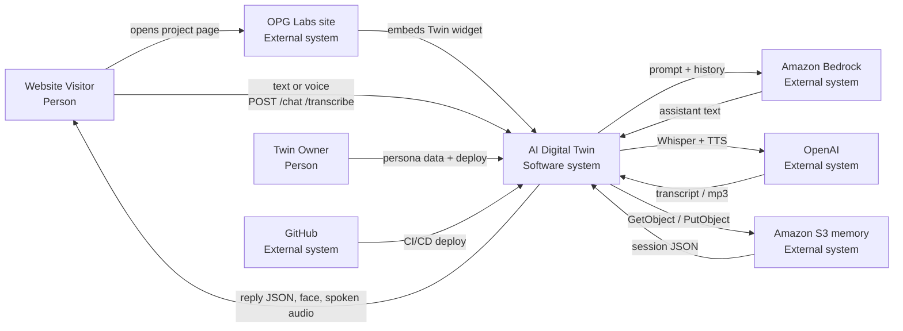
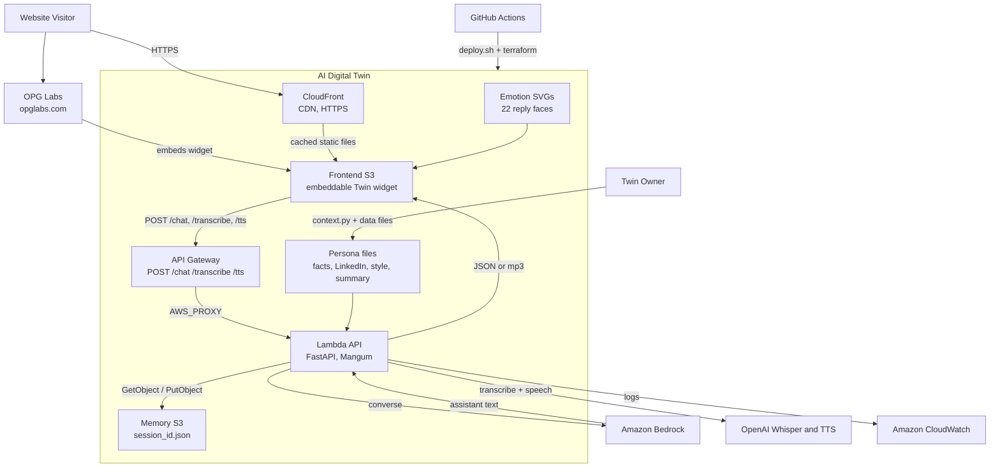
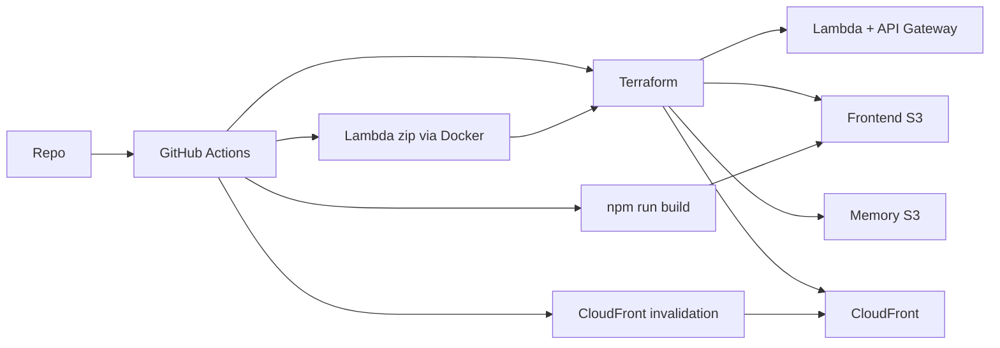

# AI Digital Twin

A conversational digital twin that answers questions about my personal preferences and architecture experiences in industry in the first person using a persona built from professional facts, LinkedIn notes, writing style, and a short summary. Visitors chat in the browser. The API keeps session memory and calls Amazon Bedrock for the reply.

## Credit

This project is based on **[twin](https://github.com/ed-donner/twin)** by **[Ed Donner](https://github.com/ed-donner)**, from the Udemy course [AI in Production](https://www.udemy.com/). Original copyright is Ed Donner's (see [LICENSE](LICENSE)). This repository is a student snapshot of that work (Next.js chat UI, FastAPI, Bedrock, session memory, Terraform, and GitHub Actions), with local additions listed below.

Course questions and contributions belong with Ed: [ed-donner/twin](https://github.com/ed-donner/twin) or ed@edwarddonner.com.

After that baseline, this fork added:

- **Additional Context Engineering** in `backend/context.py` and `backend/data/` so the model stays in character, brief, and professional
- **Transcribe** (`POST /transcribe`) with OpenAI Whisper for microphone input
- **Speak / TTS** (`POST /tts` and `POST /speak`) so replies play through the speakers.  Tested with browser speech synthesis vs. OpenAI (browser=faster vs. OpenAI=more natural).  Added functionality to disable mic until audio ended so TTS does not bleed into the next recording.
- **Emoticons** next to each assistant reply. OpenAI classifies the reply as one of 22 face labels based on the tone of the conversation (For example. Same question asked multiple times `anxious face`).
- **Embeddable frontend** — `Twin` is a self-contained React component (`frontend/components/twin.tsx`) mounted in a compact page shell so the chat widget can be dropped into another site. It is live on my very new static web [OPG Labs — Conversational Twin](https://opglabs.com/project_digital_twin/).

Locally the UI is Next.js on port 3000 and the API is FastAPI on port 8000. Production splits the static UI(S3) and the API(Lambda + API Gateway + Cloudfront) across AWS.

## Context

People and outside services around one software system. The browser never calls Bedrock, S3, or OpenAI.

## Component architecture

Text chat: UI → `/chat` → persona prompt + memory → Bedrock → `{ response, session_id, emotion }`. The UI shows the matching face SVG next to the reply.

Voice in: UI records up to 5 seconds → `/transcribe` → Whisper → same `/chat` path.

Voice out: UI → `/tts` → OpenAI speech → speakers. The mic stays paused until playback ends.

Embed: `frontend/app/page.tsx` is a thin 450px shell around `<Twin />`, so the same widget can stand alone or sit inside a host page such as [opglabs.com/project_digital_twin](https://opglabs.com/project_digital_twin/).

## Deployment architecture

GitHub Actions runs `scripts/deploy.sh`. Terraform creates AWS resources. Docker builds the Lambda zip. The frontend is a Next.js static export synced to S3, then CloudFront is invalidated. `OPENAI_API_KEY` is passed into Lambda as a Terraform variable (GitHub Actions secret, or `backend/.env` for local deploys).

Local API memory is JSON under `memory/` unless `USE_S3=true`. Production memory is a private S3 bucket.

## License

MIT. Copyright (c) 2025 Ed Donner. See [LICENSE](LICENSE).
