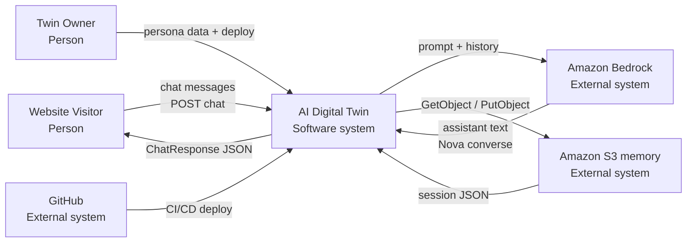
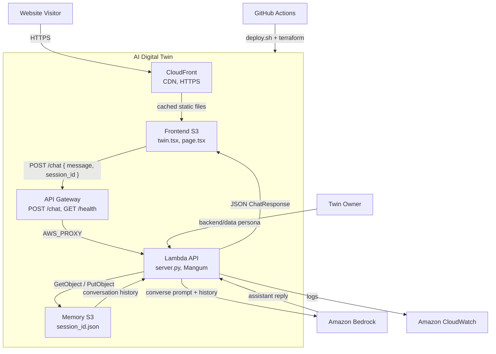
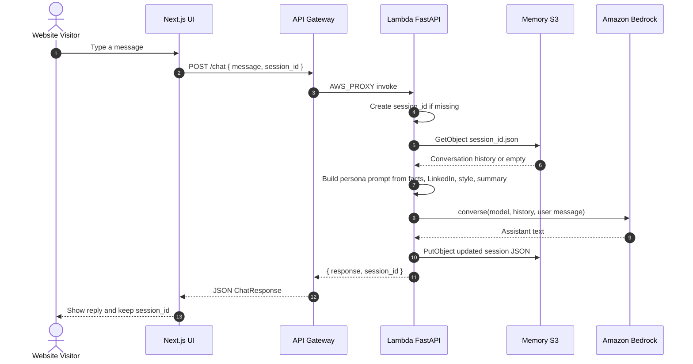
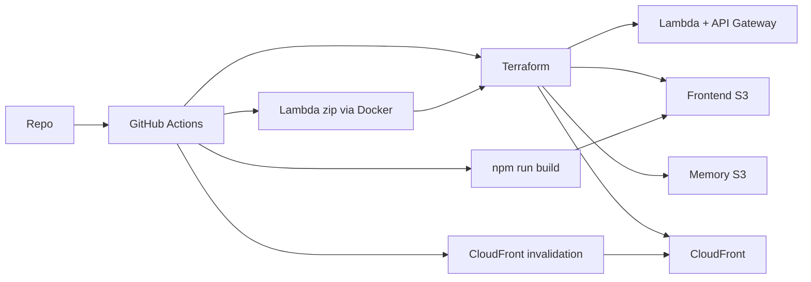

# AI Digital Twin — technical architecture

C4 Level 1 (context), Level 2 (containers), and a Level 2 zoom of the Lambda API, plus the chat request path. Production splits the UI and API across AWS. Locally the UI is Next.js on port 3000 and the API is FastAPI on port 8000.

## Context

C4 Level 1. The product is one software system. People and outside services sit around it.



The browser never calls Bedrock or S3. The FastAPI API (Lambda in production) is the only client of those two services.

## Containers

C4 Level 2. Optional C4 block, then the flowchart that actually renders.

```mermaid
---
config:
  theme: default
  themeVariables:
    background: "#ffffff"
---
C4Container
    title Container diagram for AI Digital Twin

    Person(visitor, "Website Visitor", "Chats with the twin in the browser")
    Person(owner, "Twin Owner", "Defines persona data and deploys")

    Container_Boundary(twin, "AI Digital Twin") {
        Container(cf, "CloudFront", "CDN, HTTPS", "Serves the static UI and redirects to HTTPS")
        Container(ui, "Frontend S3", "Next.js static export", "Chat UI. twin.tsx POSTs to NEXT_PUBLIC_API_URL/chat")
        Container(apigw, "API Gateway", "HTTP API", "POST /chat, GET /health, GET /. CORS and throttle")
        Container(api, "Lambda API", "Python 3.12, FastAPI, Mangum", "Session memory, persona prompt, Bedrock converse")
        Container(mem, "Memory S3", "Private bucket", "One JSON file per session_id")
    }

    System_Ext(bedrock, "Amazon Bedrock", "Nova converse API")
    System_Ext(cw, "Amazon CloudWatch", "Lambda logs and metrics")
    System_Ext(github, "GitHub", "Source and GitHub Actions CI/CD")

    Rel(visitor, cf, "HTTPS")
    Rel(cf, ui, "Cached static files")
    Rel(ui, apigw, "JSON { message, session_id }", "POST /chat")
    Rel(apigw, api, "AWS_PROXY")
    Rel(api, mem, "GetObject / PutObject")
    Rel(api, bedrock, "Prompt + history")
    Rel(bedrock, api, "Assistant reply")
    Rel(api, cw, "Logs")
    Rel(owner, api, "facts, LinkedIn, style, summary")
    Rel(github, twin, "terraform apply + s3 sync")
```

If C4 rendering is unavailable, this flowchart is the same view:



## Lambda API

Flow of one `POST /chat` request through the Lambda API.

```mermaid
---
config:
  theme: default
  themeVariables:
    background: "#ffffff"
---
flowchart TB
    apigw["API Gateway<br/>POST /chat { message, session_id }"]
    handler["lambda_handler<br/>Mangum adapter"]
    app["FastAPI app<br/>server.py"]
    chat["chat()"]
    session{"session_id<br/>present?"}
    newId["Create uuid session_id"]
    load["load_conversation()"]
    memGet["Memory S3<br/>GetObject session_id.json"]
    resources["resources.py"]
    subgraph files["Persona files backend/data"]
        facts["facts.json"]
        linkedin["linkedin.pdf"]
        style["style.txt"]
        summary["summary.txt"]
    end
    persona["prompt()<br/>context.py"]
    bedrockCall["call_bedrock()"]
    bedrock["Amazon Bedrock<br/>Nova converse"]
    append["Append user + assistant turns"]
    save["save_conversation()"]
    memPut["Memory S3<br/>PutObject session_id.json"]
    resp["ChatResponse JSON<br/>{ response, session_id }"]

    apigw --> handler --> app --> chat --> session
    session -->|no| newId --> load
    session -->|yes| load
    load --> memGet
    facts --> resources
    linkedin --> resources
    style --> resources
    summary --> resources
    resources --> persona
    memGet --> bedrockCall
    persona --> bedrockCall
    bedrockCall --> bedrock --> append --> save --> memPut --> resp
    resp --> apigw
```

## Request path



## Deployment

GitHub Actions runs `scripts/deploy.sh`. Terraform creates the AWS resources. The Lambda zip is built with Docker (`backend/deploy.py`). The frontend is a Next.js export synced to S3, then CloudFront is invalidated.



Locally the UI is `npm run dev` on port 3000 and the API is `uv run python -m uvicorn server:app --reload` on port 8000. Memory is JSON files under `memory/` unless `USE_S3=true`.
