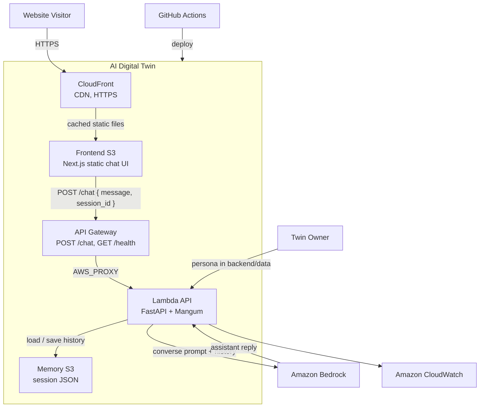
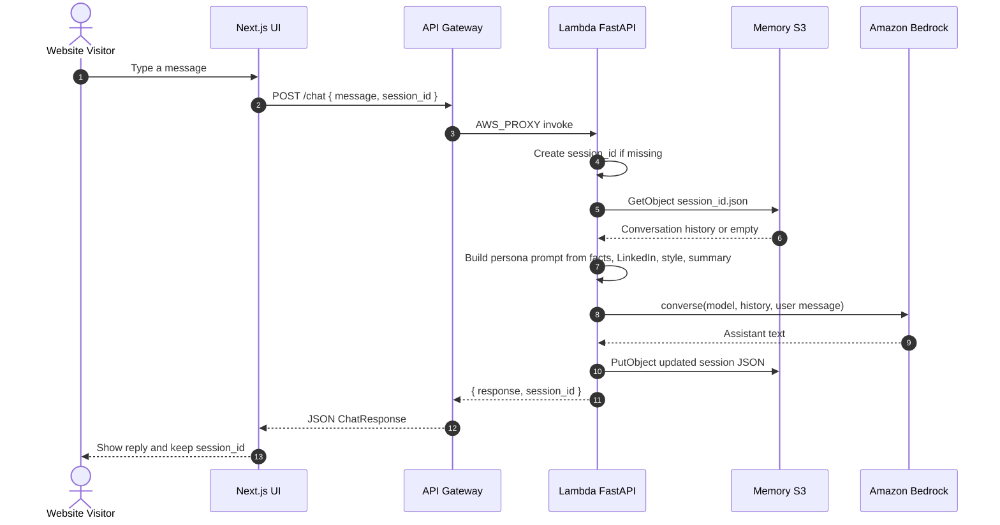
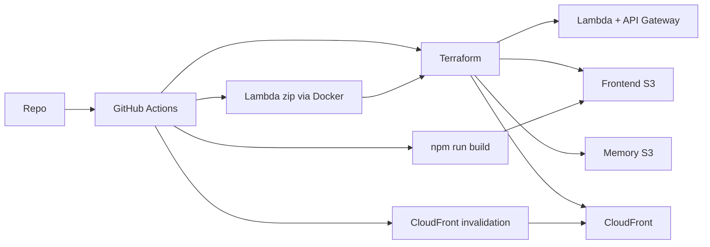

# AI Digital Twin — technical architecture

C4 Level 2 (containers) plus the chat request path. Production splits the UI and API across AWS. Locally the UI is Next.js on port 3000 and the API is FastAPI on port 8000.

```mermaid
---
config:
  theme: default
  themeVariables:
    background: "#ffffff"
---
C4Container
    title Container diagram for AI Digital Twin

    Person(visitor, "Website Visitor", "Chats with the twin in the browser")
    Person(owner, "Twin Owner", "Defines persona data and deploys")

    Container_Boundary(twin, "AI Digital Twin") {
        Container(cf, "CloudFront", "CDN, HTTPS", "Serves the static UI and redirects to HTTPS")
        Container(ui, "Frontend S3", "Next.js static export", "Chat UI. twin.tsx POSTs to NEXT_PUBLIC_API_URL/chat")
        Container(apigw, "API Gateway", "HTTP API", "POST /chat, GET /health, GET /. CORS and throttle")
        Container(api, "Lambda API", "Python 3.12, FastAPI, Mangum", "Session memory, persona prompt, Bedrock converse")
        Container(mem, "Memory S3", "Private bucket", "One JSON file per session_id")
    }

    System_Ext(bedrock, "Amazon Bedrock", "Nova converse API")
    System_Ext(cw, "Amazon CloudWatch", "Lambda logs and metrics")
    System_Ext(github, "GitHub", "Source and GitHub Actions CI/CD")

    Rel(visitor, cf, "HTTPS")
    Rel(cf, ui, "Cached static files")
    Rel(ui, apigw, "JSON { message, session_id }", "POST /chat")
    Rel(apigw, api, "AWS_PROXY")
    Rel(api, mem, "GetObject / PutObject")
    Rel(api, bedrock, "Prompt + history")
    Rel(bedrock, api, "Assistant reply")
    Rel(api, cw, "Logs")
    Rel(owner, api, "facts, LinkedIn, style, summary")
    Rel(github, twin, "terraform apply + s3 sync")
```

If C4 rendering is unavailable, this flowchart is the same view:



## Request path



## Deployment

GitHub Actions runs `scripts/deploy.sh`. Terraform creates the AWS resources. The Lambda zip is built with Docker (`backend/deploy.py`). The frontend is a Next.js export synced to S3, then CloudFront is invalidated.



Locally the UI is `npm run dev` on port 3000 and the API is `uv run python -m uvicorn server:app --reload` on port 8000. Memory is JSON files under `memory/` unless `USE_S3=true`.
