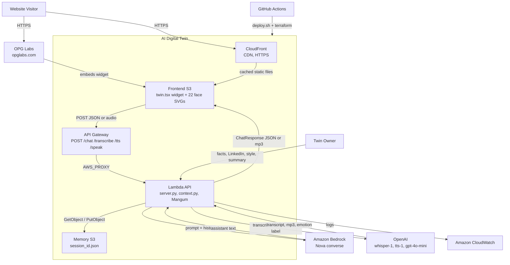
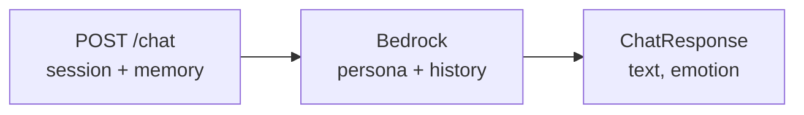
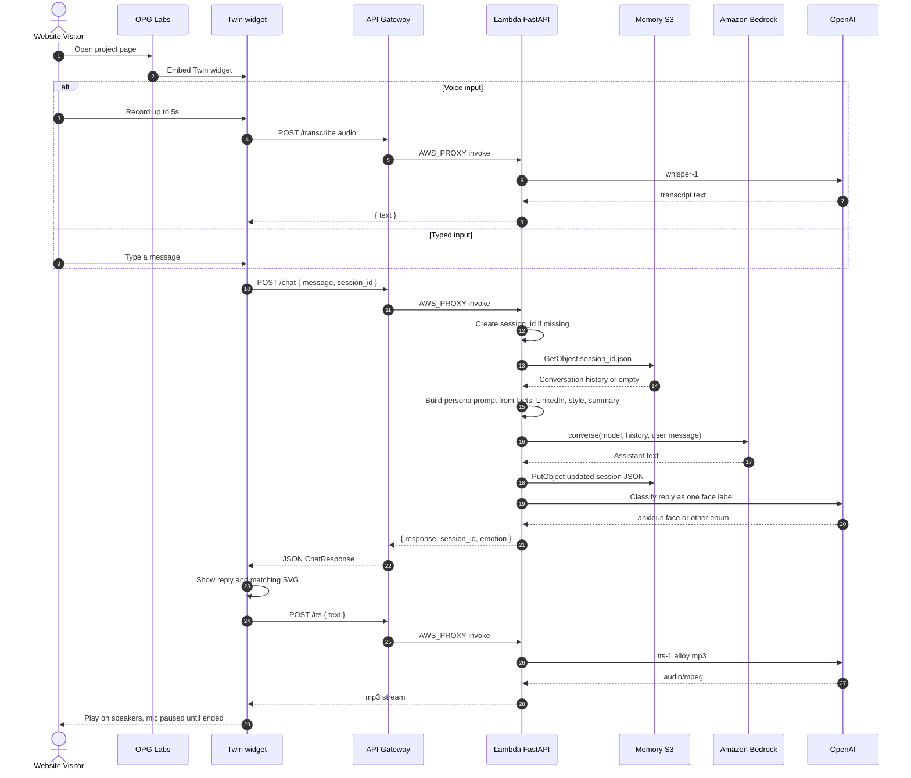
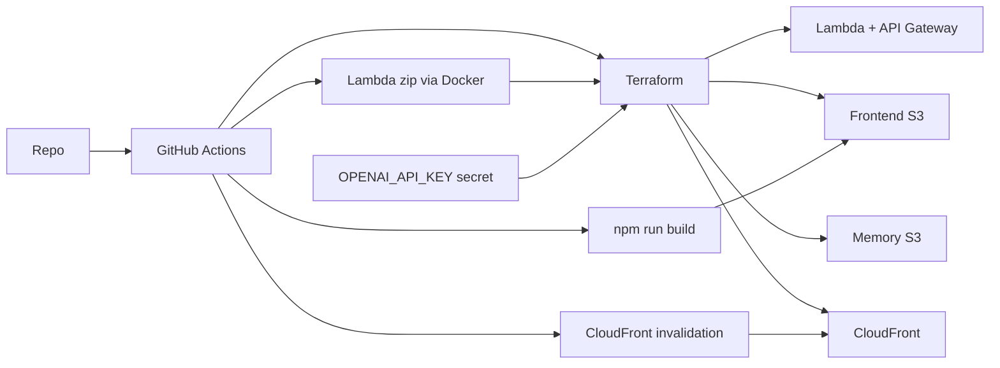

# AI Digital Twin — technical architecture

C4 Level 1 (context), Level 2 (containers), a Level 2 zoom of the Lambda API, plus the request path. Production splits the static UI and API across AWS. Locally the UI is Next.js on port 3000 and the API is FastAPI on port 8000. The chat widget is embeddable (live on [OPG Labs](https://opglabs.com/project_digital_twin/)).

## Containers

C4 Level 2. People and externals sit outside the system boundary. Emotion SVGs ship with the frontend. Persona files are packaged into the Lambda zip.

## Lambda API

One `POST /chat`. Persona files are assembled in `prompt()`. Emotion is classified after the reply is saved.

Voice in is a separate `POST /transcribe` (Whisper) that returns transcript text for the same `/chat` path. Voice out is `POST /tts` or `POST /speak` (`tts-1` mp3). The UI pauses the mic until playback ends.

## Request path

## Deployment

GitHub Actions runs `scripts/deploy.sh`. Terraform creates the AWS resources. The Lambda zip is built with Docker (`backend/deploy.py`). The frontend is a Next.js export synced to S3, then CloudFront is invalidated. `OPENAI_API_KEY` is required (GitHub Actions secret, or `backend/.env` for local deploys) and is passed into Lambda as `TF_VAR_openai_api_key`.

Locally the UI is `npm run dev` on port 3000 and the API is `uv run server.py` on port 8000. Memory is JSON files under `memory/` unless `USE_S3=true`. Production memory is a private S3 bucket. `frontend/app/page.tsx` is a 450px shell around `<Twin />` so the same widget can stand alone or sit inside a host page.
